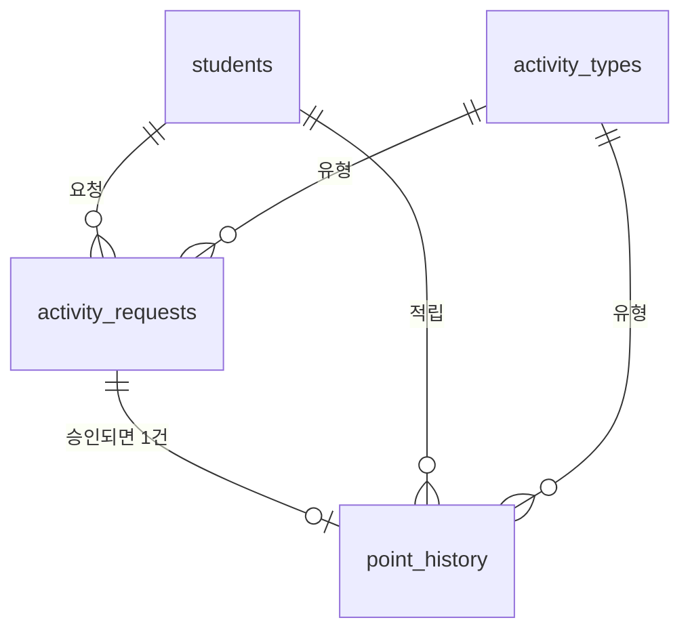

<div align="center">

# 📒 Study P

**공부방 도장판을 데이터로 바꾸고, 요청이 오면 SQL로 뽑아 검증해서 전달하는 프로젝트**


</div>

---

## 한눈에 보기

| | |
|---|---|
| **문제** | 공부방 보상 기록이 종이 도장판에만 있어서, "이번 주 몇 번 왔어요?" 같은 질문에 바로 답할 수 없음 |
| **한 일** | 기록을 MySQL로 구조화 → 실제 공부방에서 시범 운영 → 부모님 질문을 요청서로 받아 SQL로 추출·검증 → 엑셀 피벗으로 전달 |
| **결과** | 시범 운영 _○일_, 학생 _○명_, 기록 _○건_, 요청 _○건_ 처리, 예외 케이스 _○개_ 발견·규칙화 |

## 요청 처리 사례

모든 요청은 같은 순서로 처리했습니다: **요청서 → 추출 기준 → 쿼리 → 검증 → 예외 처리 → 전달**

| # | 요청 (누가, 무엇을) | 쓴 SQL | 검증한 것 | 발견한 예외 |
|---|---|---|---|---|
| R1 | _작성 예정_ | | | |
| R2 | _작성 예정_ | | | |
| R3 | _작성 예정_ | | | |

요청별 상세: [`requests/`](requests/)

## 데이터 구조



잘못된 데이터는 DB 단계에서 막습니다.

| 막는 것 | 방법 |
|---|---|
| 같은 요청이 두 번 적립 | `point_history.request_id` UNIQUE |
| 대기 중인데 처리 시각이 있음 | CHECK `chk_req_review` |
| 사유 없는 거절 | CHECK `chk_req_reject_reason` |
| 없는 활동 유형 | 외래키 → `activity_types` |

스키마: [`mysql/01_schema.sql`](mysql/01_schema.sql) · 이전 과정: [`mysql/README.md`](mysql/README.md)

## 이전 분석: 테스트 시나리오 검증

시범 운영 전에 테스트 시나리오(학생 3명)로 분석 로직을 먼저 검증했습니다.

- **단일 분류 → 독립 Flag로 개선.** 처음에는 `CASE WHEN` 하나로 학생 유형을 나눴는데, 조건을 여러 개 만족해도 하나만 나오는 문제를 발견해 Flag를 따로 두도록 바꿨습니다. → [`monthly_pattern_flags.sql`](mysql/analysis/monthly_pattern_flags.sql)
- **CTE + `LAG()`로 전월 대비 변화량.** 증가(+4) / 감소(-3) / 유지(0)가 기대값과 일치했습니다. → [`monthly_change_lag.sql`](mysql/analysis/monthly_change_lag.sql)

| 시나리오 | 8월 | 9월 | 변화 | 등원 편중 | 후반 감소 | 활동 다양 |
|---|---:|---:|---:|:---:|:---:|:---:|
| A | 7 | 11 | +4 | - | Y | Y |
| B | 12 | 9 | -3 | Y | Y | - |
| C | 9 | 9 | 0 | - | Y | Y |

## 폴더 구조

```text
study-p/
├── mysql/
│   ├── 01_schema.sql            테이블·제약 조건
│   ├── 02_seed_activity_types.sql
│   ├── analysis/                분석 쿼리
│   └── fixtures/                테스트 시나리오 데이터
├── requests/                    요청서와 처리 기록 (시범 운영 중 추가)
├── legacy-sqlite/               이전 Cloudflare D1(SQLite) 쿼리
└── docker-compose.yml           로컬 MySQL 실행
```

## 실행

```bash
docker compose up -d
docker compose exec -T mysql mysql -uroot -pstudyp < mysql/fixtures/portfolio_test_scenarios.sql
docker compose exec -T mysql mysql -uroot -pstudyp study_p < mysql/analysis/monthly_change_lag.sql
```

## 개인정보

학생은 별칭(S01 등)으로만 저장합니다. 실제 이름, 사진 증빙, API 키는 저장소에 올리지 않습니다.
